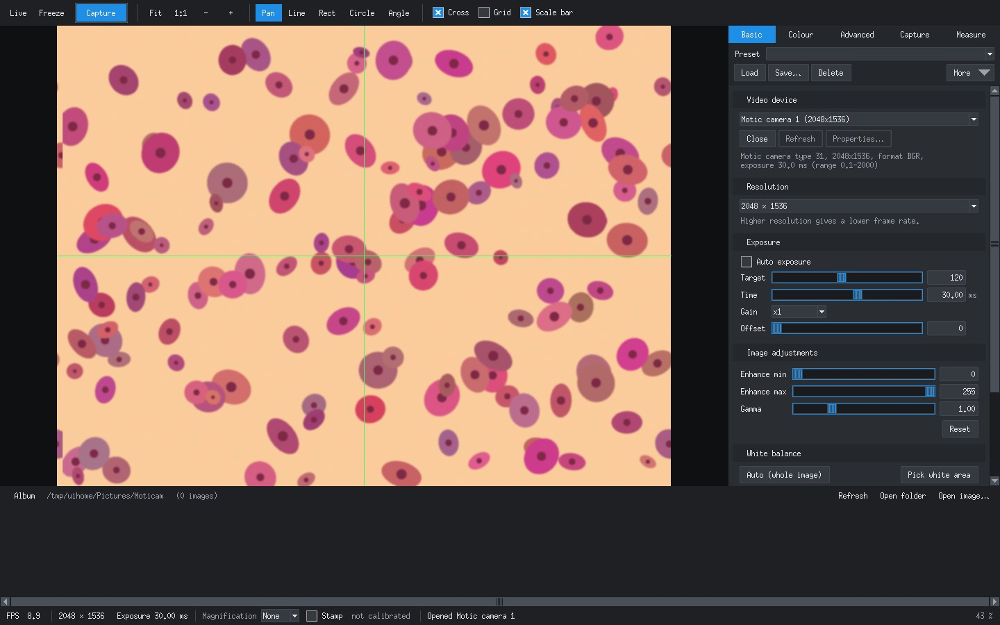
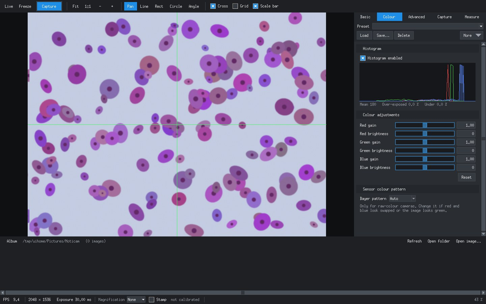
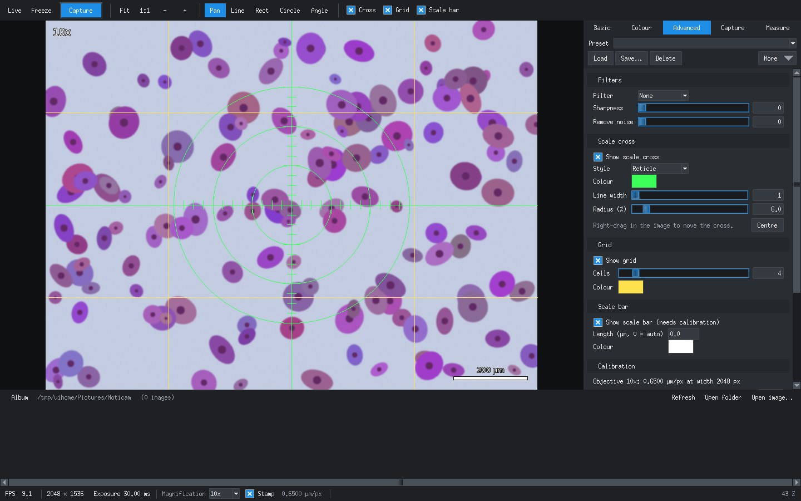
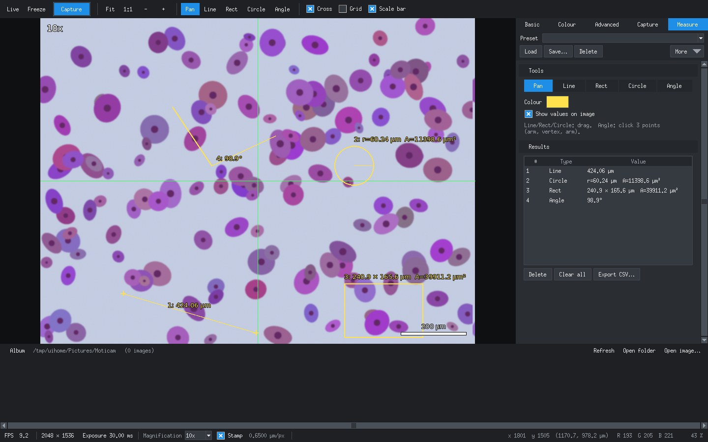
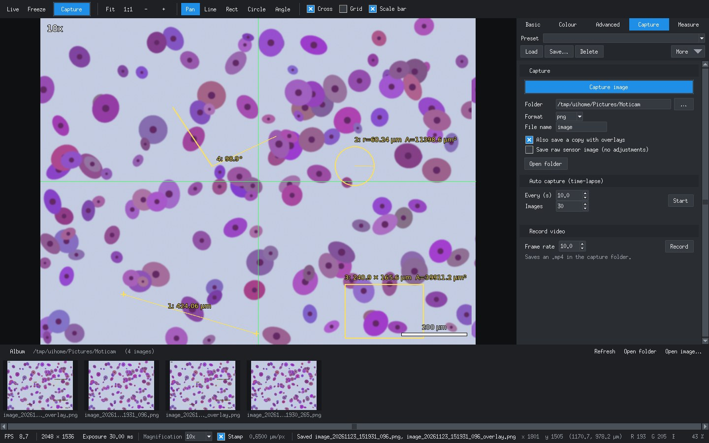
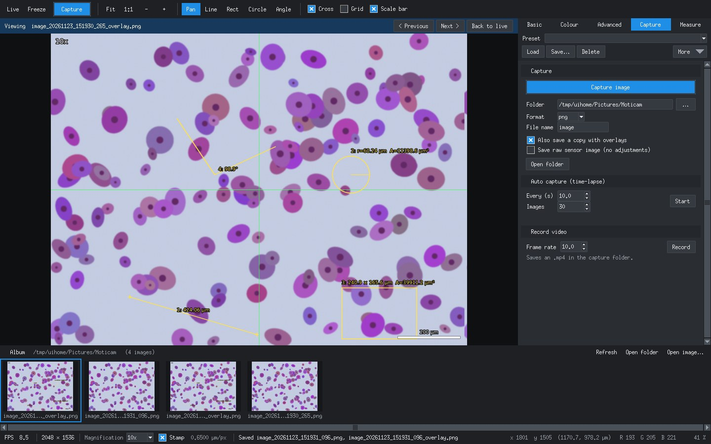
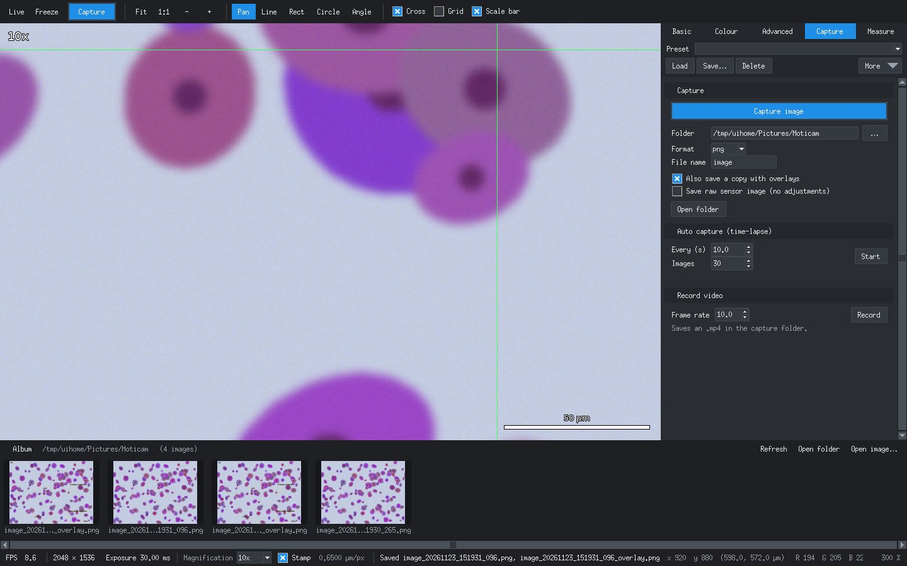
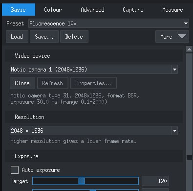

# moticam

Live imaging, capture and measurement for Moticam microscope cameras on Windows.

Motic USB cameras (for example the *Motic USB3 Camera*, USB ID `232F`) are not standard
webcams. This program talks to them through Motic's own camera library (`MUCam32.dll`,
installed with Motic Images Plus 3.0) and also works with ordinary webcams through DirectShow.



> Screenshots were taken with a simulated camera, so the sample image is synthetic.

## Contents

- [Quick start](#quick-start)
- [Features](#features)
- [Standalone version](#standalone-version)
- [Camera driver](#camera-driver)
- [Command line tool](#command-line-tool)
- [Project layout](#project-layout)

## Quick start

1. Install **Motic Images Plus 3.0 (64-bit)**. It provides the camera driver and `MUCam32.dll`.
2. Close Motic Images Plus (only one program can use the camera at a time).
3. In this folder:

   ```
   uv sync
   uv run moticam-ui
   ```

The first Motic camera found is opened automatically.

## Features

### Live view and camera controls

The image is in the middle, the control panel on the right and the album of captured images
along the bottom. The status bar shows frame rate, resolution, exposure, objective
magnification, calibration, cursor position and the pixel colour under the cursor.

**Basic** page: video device, resolution, exposure (manual, or automatic with a target
brightness), gain, offset, enhance (black / white levels), gamma, white balance (automatic,
from a picked white area, or Halogen / LED presets), mirror and flip.

| Mouse in the image | |
|---|---|
| Wheel | zoom at the cursor |
| Double-click | fit to window |
| Left drag | pan, or draw with the selected measuring tool |
| Right drag | move the scale cross |
| Middle drag | pan |

Keys: `Space` capture, `F` fit, `1` 100 %, `Z` freeze, `Esc` cancel / back to live,
`Delete` remove selected measurement, `Left` / `Right` previous / next image.

### Colour and histogram

Live RGB histogram with mean brightness and over / under-exposure warning, red / green / blue
gain and brightness, and the Bayer pattern choice for raw-colour sensors.



### Scale cross, grid, scale bar and calibration

**Advanced** page: filters (grayscale, invert, single channel), sharpness, noise removal,
four scale-cross styles (full lines, small cross, circle + cross, reticle) with colour, width
and size, a grid, and a scale bar. The objective (status bar) can be stamped on the image.

Calibration is kept per objective: draw a line across a known distance on a calibration slide
and use *From measured line*, or type the µm per pixel. Changing the resolution rescales the
calibration automatically.



### Measurements

Line, rectangle, circle and angle tools. Values are shown on the image and in the results
table, in µm when calibrated. Export the table as CSV.



### Capture, time-lapse, video and album

**Capture** page: folder, format (PNG / JPG / TIFF / BMP), file name, an extra copy with the
overlays and measurements drawn in, raw sensor image option, time-lapse (interval and count)
and video recording (.mp4). Captured images appear in the album.



### Image viewer

Click an album thumbnail to open it. Zoom, measure and step through images, then
*Back to live*.



### Zoom and pixel readout

Zoom up to 4000 %. The status bar shows the cursor position in pixels and µm and its RGB value.



### Presets

Save everything set in the control panel under a name and load it again later. Presets are
files in `%USERPROFILE%\.moticam\presets` and can be exported and imported to share them.
Calibrations and the capture folder are not part of a preset.



## Standalone version

Build a folder that runs on PCs without Python:

```
build.bat
```

(or `uv run --group build python scripts/build_standalone.py`). Run it on a PC where the camera
already works. It creates:

```
dist/MoticamCapture/
    MoticamCapture.exe        the program
    _internal/motic/          MUCam32.dll and the DLLs it needs, copied from Motic Images Plus
    driver/                   the Motic camera driver package from the Windows driver store
    install_driver.bat/.ps1   installs that driver
    README.txt
dist/MoticamCapture-<version>-win64.zip
```

Options: `--motic-dll PATH`, `--driver-dir PATH`, `--no-driver`, `--no-zip`.

The bundled DLL and driver are Motic's software. That is fine for your own lab's computers;
ask Motic before giving the package to others.

## Camera driver

On a new PC, copy the `MoticamCapture` folder and start the program. If a Motic camera is
plugged in but has no driver, the program offers to install the bundled one (Windows asks for
administrator permission). You can also run `install_driver.bat` yourself, or use
*Basic > Video device > Driver…* to check the status. Unplug and reconnect the camera after
installing.

## Command line tool

```
uv run moticam --list          # Motic SDK cameras and webcams
uv run moticam --diag          # driver status, DirectShow devices, Motic files
uv run moticam --inspect-motic # Motic DLLs, 32/64-bit, exported functions
uv run moticam                 # simple preview window, SPACE captures
uv run moticam --interval 10 --count 30 --no-preview   # time-lapse
```

## Project layout

```
src/moticam/ui.py          live imaging window
src/moticam/cameras.py     camera sources (Motic SDK, DirectShow) and capture thread
src/moticam/motic_sdk.py   ctypes wrapper for Motic's MUCam DLL
src/moticam/driver.py      driver status check and installer launch
src/moticam/capture.py     command line tool
scripts/build_standalone.py, scripts/install_driver.ps1, build.bat
docs/images/               README screenshots
```
